每組左側是原圖，右側是深度圖。點圖可放大。

我們用灰階深度圖判讀胸腹的體積，以及四肢和尾巴的遮擋。同一張圖上，越亮表示估計越靠近鏡頭。深度圖由 [Depth Anything V2 Small](https://github.com/DepthAnything/Depth-Anything-V2) 產生。

- [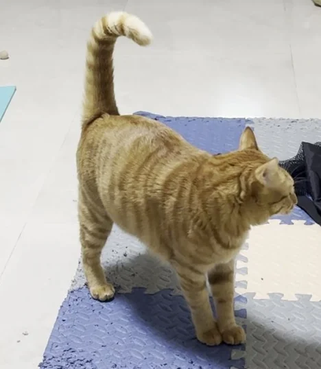](/books/leo/images/standing.webp) [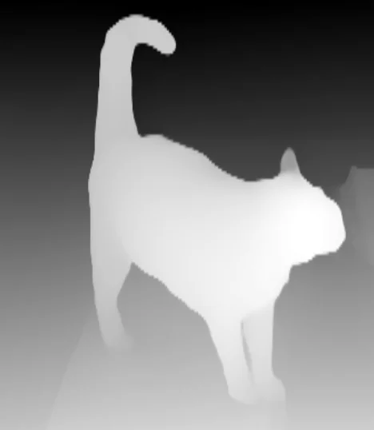](/books/leo/images/standing-depth.webp)\
  _斜前站姿 · 胸腹厚度_
- [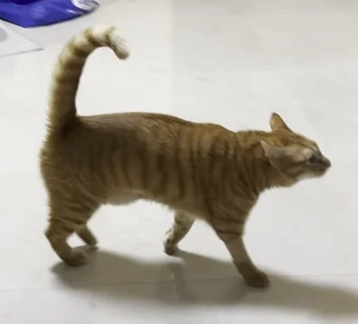](/books/leo/images/side.webp) [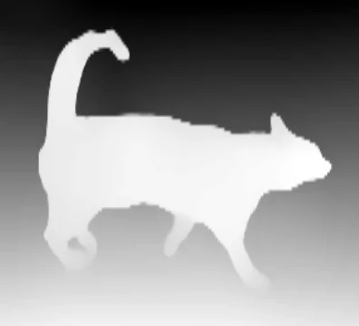](/books/leo/images/side-depth.webp)\
  _側面跨步 · 背線與後腹_
- [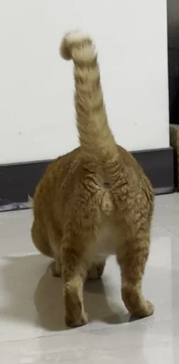](/books/leo/images/rear.webp) [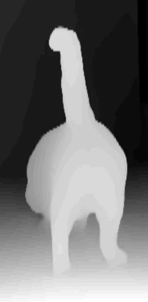](/books/leo/images/rear-depth.webp)\
  _後方 · 臀寬與站距_
- [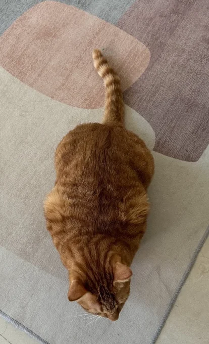](/books/leo/images/top.webp) [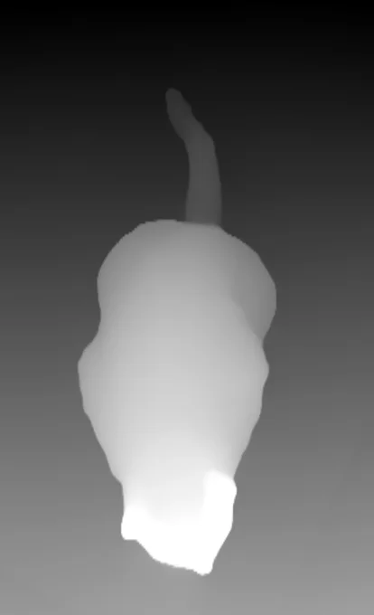](/books/leo/images/top-depth.webp)\
  _俯視 · 軀幹寬度_
- [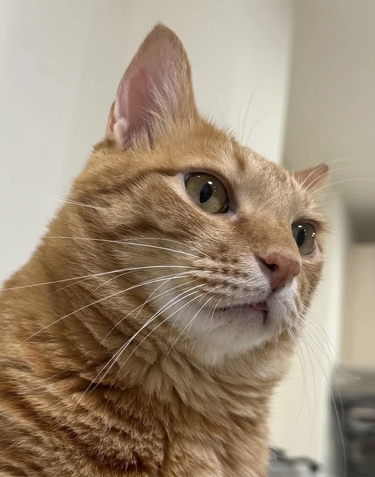](/books/leo/images/face.webp) [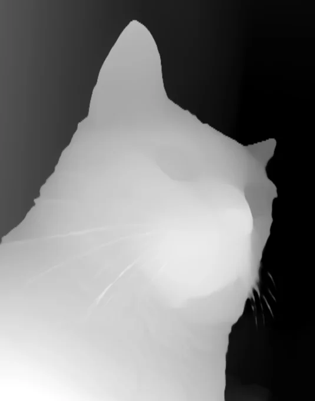](/books/leo/images/face-depth.webp)\
  _臉部 · 耳形與鼻口_
- [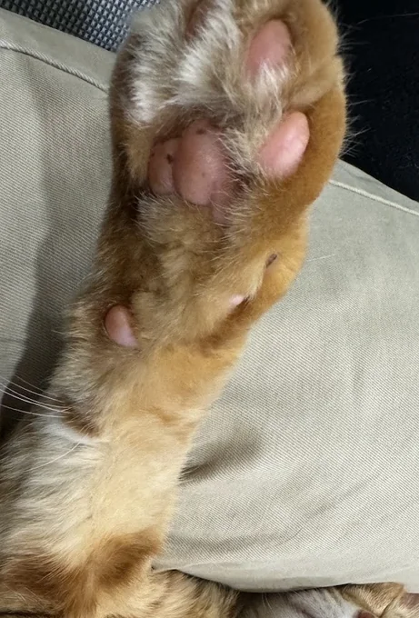](/books/leo/images/paw.webp) [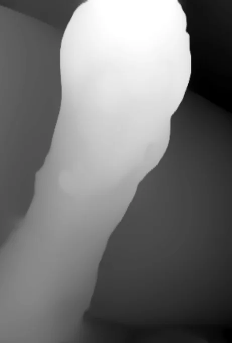](/books/leo/images/paw-depth.webp)\
  _前腳 · 肉墊與趾墊_
- [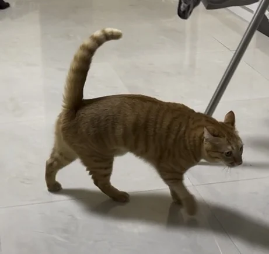](/books/leo/images/walking.webp) [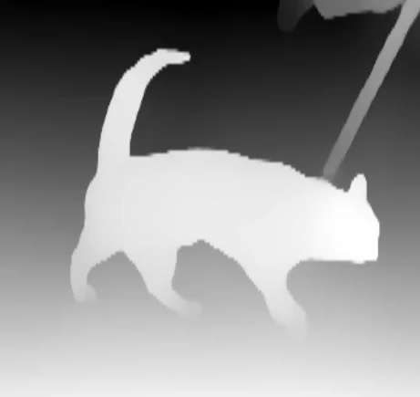](/books/leo/images/walking-depth.webp)\
  _側面走路 · 前後腳落點_
- [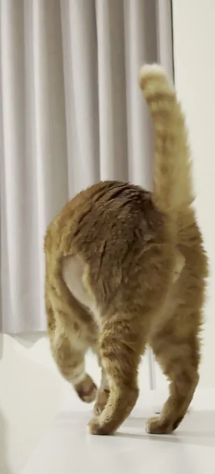](/books/leo/images/low-rear.webp) [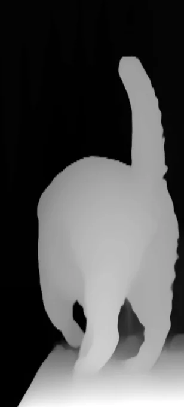](/books/leo/images/low-rear-depth.webp)\
  _低角度後方 · 後腿折角_
- [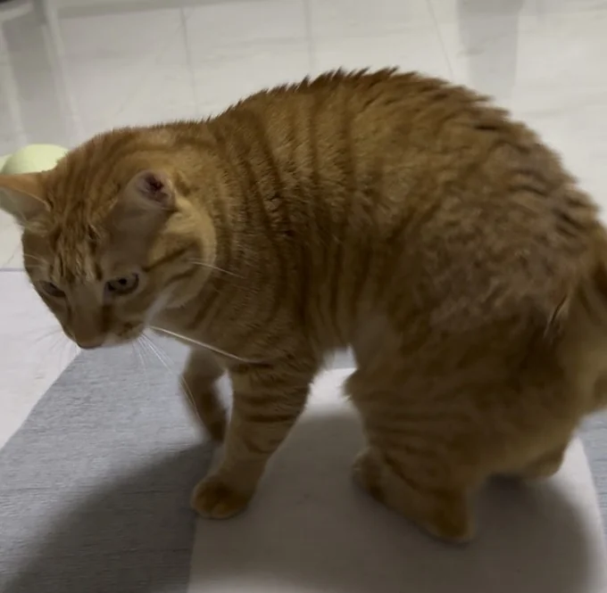](/books/leo/images/rising.webp) [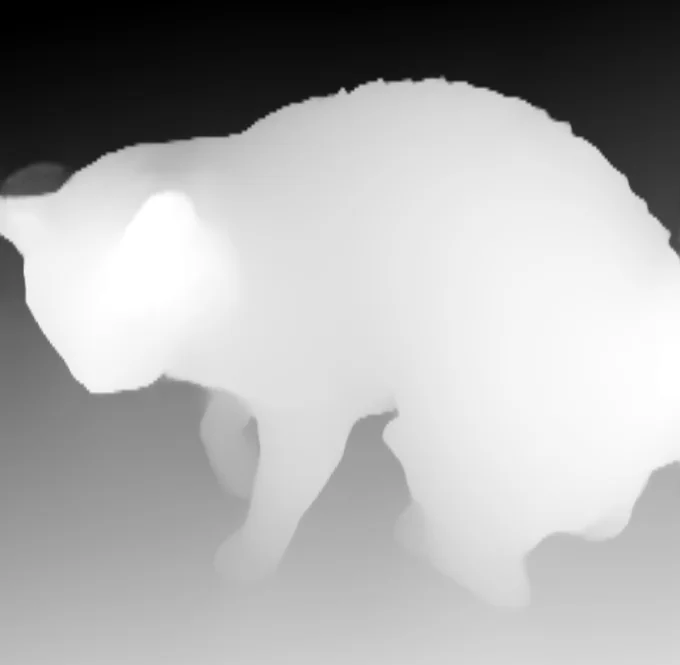](/books/leo/images/rising-depth.webp)\
  _起身轉向 · 肩臀起伏_
- [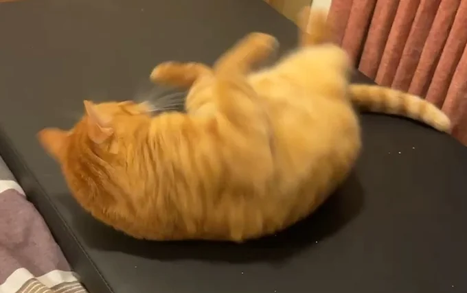](/books/leo/images/rolling.webp) [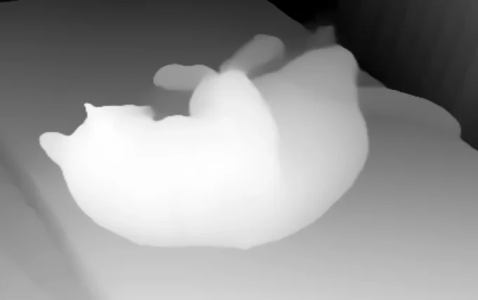](/books/leo/images/rolling-depth.webp)\
  _側躺翻身 · 四肢收起_
- [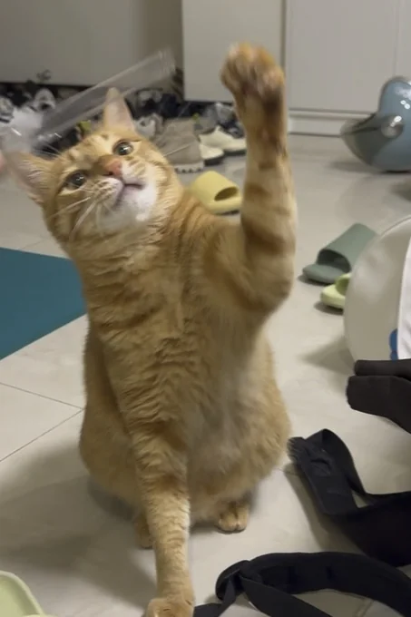](/books/leo/images/reaching.webp) [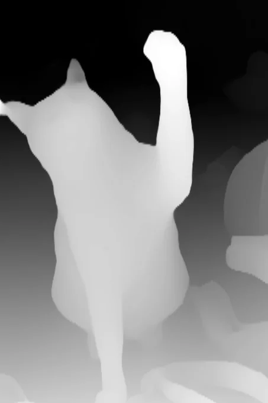](/books/leo/images/reaching-depth.webp)\
  _前腳上探 · 後腳支撐_
- [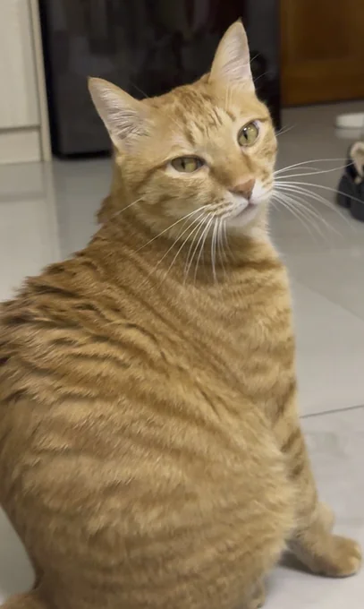](/books/leo/images/looking-back.webp) [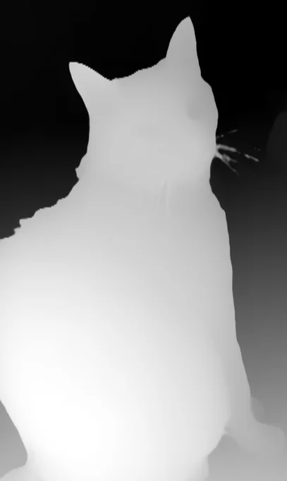](/books/leo/images/looking-back-depth.webp)\
  _坐姿回頭 · 肩背與尾根_
